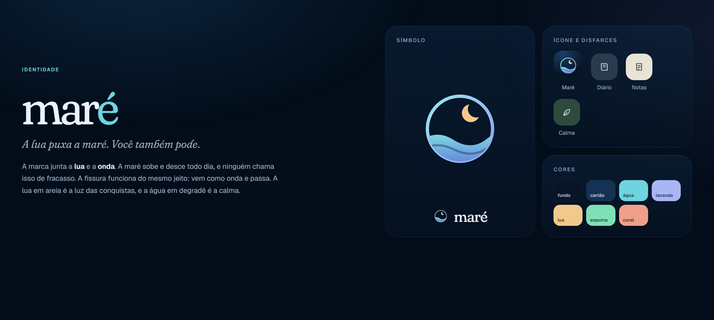
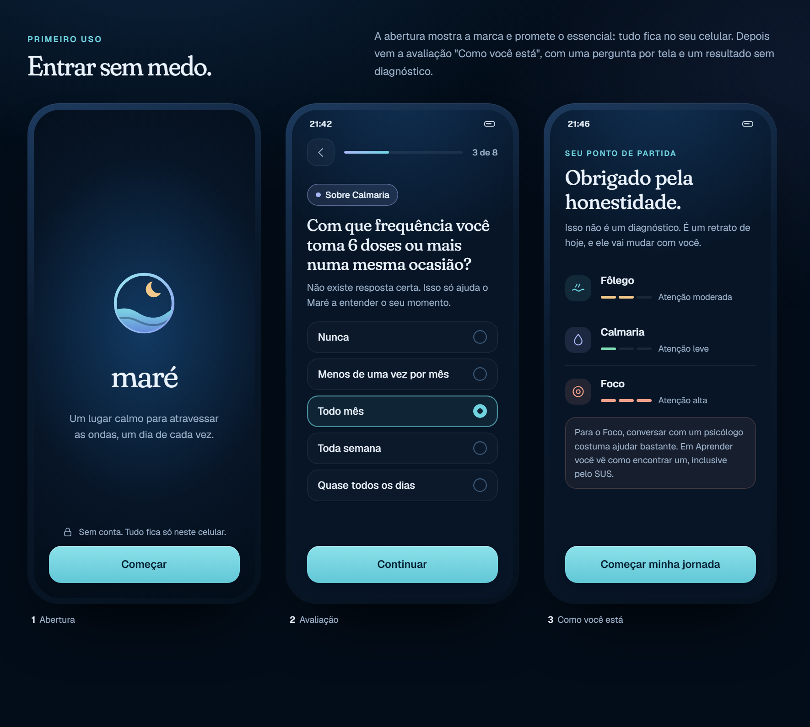
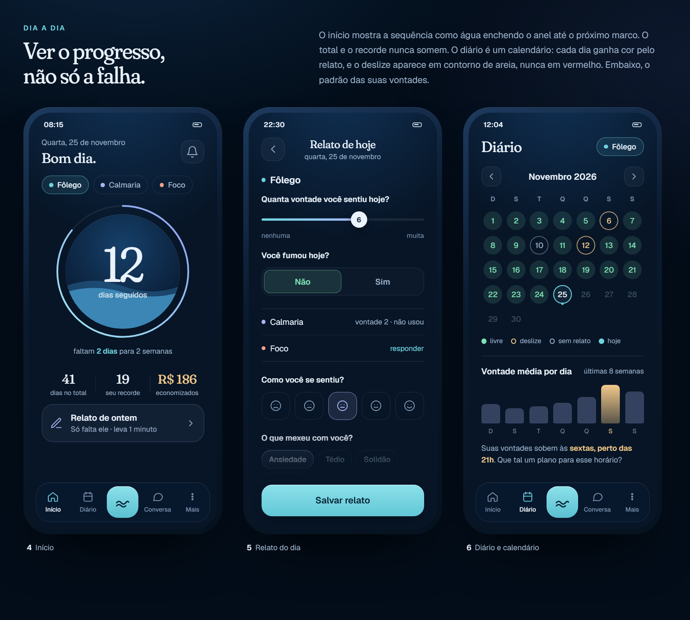
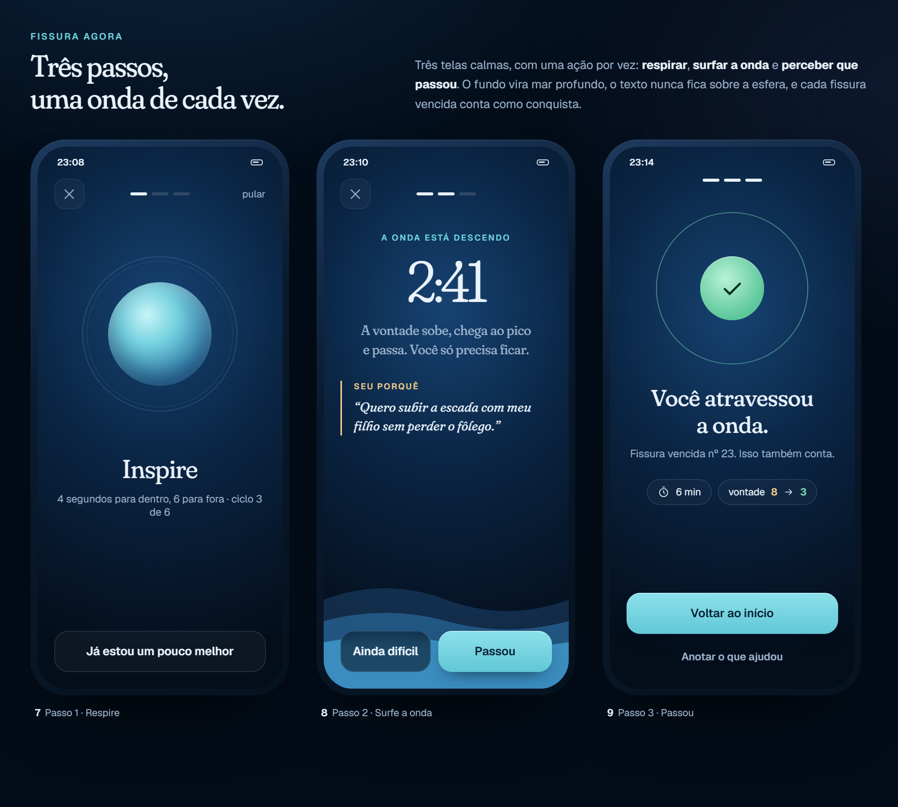
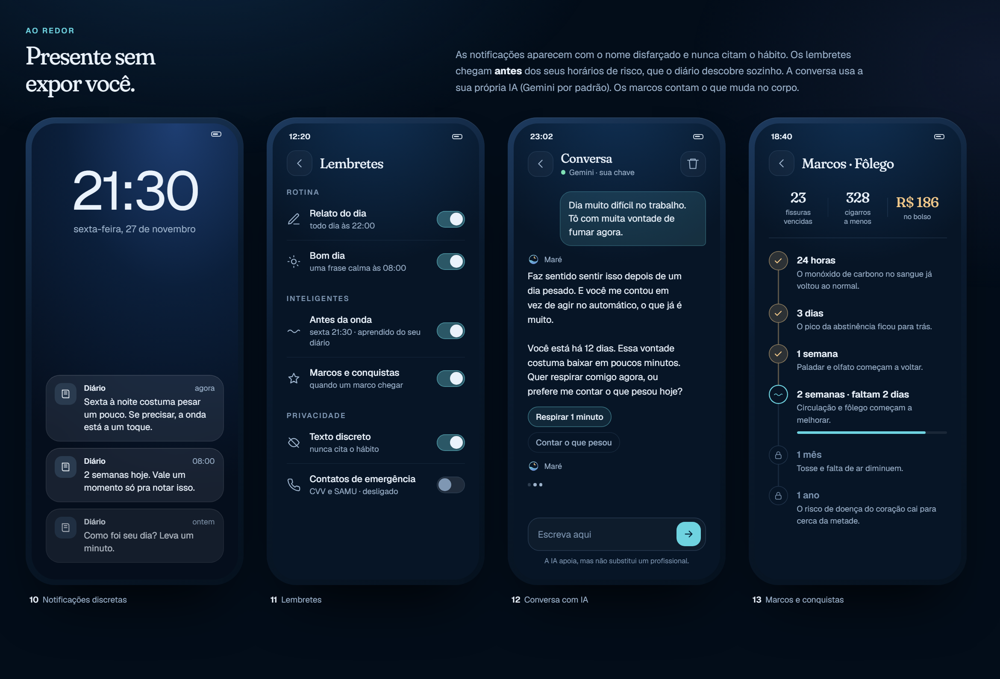

<h1>
  
</h1>

<p align="center">
  <b>Um app gratuito e de código aberto para atravessar as ondas,<br>um dia de cada vez.</b>
</p>

<p align="center">
  Android · offline · sem conta · em português · licença MIT
</p>

---

O **Maré** ajuda quem quer **parar ou diminuir** três hábitos:
- **cigarro e nicotina** (inclusive vape);
- **álcool**;
- **pornografia e masturbação compulsiva**.

Muitos apps de acompanhamento cobram para funcionar de verdade. Aqui tudo é livre, porque as pessoas merecem isso.

> **Status:** em desenvolvimento (versão 0.3.0). Prontos: núcleo diário, primeiro uso com a avaliação "Como você está", Fissura em 3 passos, "Recomeçar com cuidado", Meu plano, Aprender, Apoio e a conversa com IA (Gemini, ChatGPT ou Claude). Também prontos: lembretes discretos, bloqueio por PIN ou digital, disfarce de nome e ícone e backup cifrado. Ainda não há APK público: falta conferir no celular ([roteiro](docs/verificacao-android.md)) e preparar o lançamento.

## Por que "Maré"

A maré sobe e desce todo dia, e ninguém chama isso de fracasso. A vontade funciona do mesmo jeito: vem como onda, chega ao pico e passa. A marca junta a **lua** (a luz das conquistas) e a **onda** (a calma). *A lua puxa a maré. Você também pode.*

## Como ele ajuda

<p align="center">
  
</p>

- **Como você está:** uma avaliação curta, uma pergunta por tela, baseada em questionários reconhecidos (como o AUDIT-C da OMS). O resultado é acolhedor e **não é diagnóstico**.
- **Relato do dia:** em 1 minuto você conta a vontade (0 a 10), se usou e o que mexeu com você.
- **Contador que não pune:** um deslize **não apaga sua história**. Você vê a sequência atual, o total de dias e o seu recorde.

<p align="center">
  
</p>

- **Diário com calendário:** cada dia ganha uma cor suave, e o deslize aparece em contorno de areia, nunca em vermelho. O app mostra em que dias da semana suas vontades sobem.

<p align="center">
  
</p>

- **Fissura agora:** um botão no centro do app. Em 3 passos calmos, você respira, surfa a onda lembrando do seu porquê e percebe que passou. Cada fissura vencida conta como conquista.

<p align="center">
  
</p>

- **Lembretes discretos:** as notificações usam o nome disfarçado do app e nunca citam o hábito. O lembrete "antes da onda" chega antes dos seus horários mais difíceis.
- **Marcos:** o que muda no corpo com 24 horas, 3 dias, 1 semana, 1 ano. Mostra também quanto dinheiro você economizou.
- **IA de cada um (opcional):** converse com o **Gemini**, o **ChatGPT** ou o **Claude** usando a **sua própria chave**. A chave fica no celular ou no seu servidor no Render. Sem IA, o app funciona por inteiro.

## Privacidade em primeiro lugar

Vício costuma vir com vergonha. Por isso:

- **Sem conta.** Nada de e-mail ou cadastro.
- **Os dados ficam só no seu celular, criptografados.**
- **Bloqueio** por digital ou PIN.
- **Disfarce:** nome e ícone neutros, como "Diário", "Notas" ou "Calma".
- **Nenhuma imagem de cigarro, bebida ou conteúdo sexual**, porque imagens assim despertam a vontade.
- **Código aberto:** qualquer pessoa pode conferir o que o app faz.

## Baseado em evidência

As decisões do app vêm de uma pesquisa sobre por que os vícios acontecem e o que funciona para sair deles:
- Terapia Cognitivo-Comportamental, Entrevista Motivacional, ACT e prevenção de recaída;
- mindfulness, incluindo "surfar a fissura";
- grupos de apoio;
- os tratamentos que existem, inclusive no SUS.

O app **informa e incentiva a procurar ajuda**, mas **não diagnostica, não prescreve e não substitui** um profissional de saúde.

- [Pesquisa de fundamentos](docs/01-pesquisa-fundamentos.md): neurociência, terapias, remédios (só informativo), rede de apoio no Brasil, cores e design calmante.
- [Provedores de IA](docs/02-provedores-ia.md): como o app conversa com Gemini, OpenAI e Claude, e o que cada um faz com seus dados.

## Design

- [Documento de design](docs/superpowers/specs/2026-11-25-app-sobriedade-design.md): objetivos, telas, dados, segurança e escopo da v1.
- [Telas em alta fidelidade](docs/design/mockups-v2.html): abra no navegador.
- **Cores:** azul-marinho profundo (`#071526`), água-marinha (`#6FD3E0`), lavanda (`#A9B6F5`), areia (`#F2C98A`) e espuma (`#7FE0B5`).
- **Fontes:** [Fraunces](https://fonts.google.com/specimen/Fraunces) para números e frases de acolhimento, [Geist](https://fonts.google.com/specimen/Geist) para a interface.

## Roteiro

| | Etapa | O que entrega |
|---|---|---|
| ✓ | [1 · Núcleo diário](docs/superpowers/plans/2026-11-26-mare-plano-1-nucleo.md) | Hábitos, relato diário, contador, início, calendário, marcos, dados criptografados |
| ✓ | 2 · Primeiro uso e cuidado | Avaliação "Como você está", fissura em 3 passos, porquês, biblioteca |
| ✓ | 3 · Lembretes e privacidade | Notificações discretas, "antes da onda", bloqueio, disfarce, backup cifrado |
| ✓ | 4 · IA de cada um | Conversa com Gemini, ChatGPT ou Claude, servidor opcional no Render |
| ○ | 5 · Lançamento | APK no GitHub, primeira versão beta |

Detalhes em [docs/superpowers/plans/2026-11-26-mare-roteiro.md](docs/superpowers/plans/2026-11-26-mare-roteiro.md).

## Tecnologia

[Expo](https://expo.dev) (React Native) com TypeScript, Expo Router, Zustand e SQLite criptografado (SQLCipher). Os testes de lógica usam [Vitest](https://vitest.dev).

```bash
npm ci
npm run web        # abre no navegador (modo celular do DevTools)
npm test           # testes da lógica
npm run apk:teste  # gera um APK de teste em dist/ (precisa do Android SDK)
```

## Servidor de IA no Render (opcional)

Quem não quer a chave da IA no celular pode usar um servidor próprio no plano gratuito do [Render](https://render.com). O servidor fica em [`servidor/servidor-ia.mjs`](servidor/servidor-ia.mjs): é Node puro, sem dependências, e não guarda nem registra as conversas.

1. No Render, crie um *Blueprint* a partir deste repositório (usa o [`render.yaml`](render.yaml)) ou um *Web Service* com `node servidor/servidor-ia.mjs`.
2. Em **Environment**, preencha `IA_CHAVE` com a sua chave e `APP_TOKEN` com um código longo (24 caracteres ou mais). `IA_PROVEDOR` (`gemini`, `openai` ou `claude`) e `IA_MODELO` são opcionais.
3. No app: **Mais → Inteligência artificial → Meu servidor**, cole o endereço `https://…onrender.com` e o código, e toque em **Testar conexão**. No plano gratuito, o servidor leva até 1 minuto para acordar.

## Contribuir

Ideias, correções e revisões são bem-vindas, especialmente de **profissionais de saúde mental**, que podem revisar os textos. Abra uma *issue* ou um *pull request*.

## Precisa de ajuda agora?

Se você está em sofrimento, não precisa passar por isso só:
- **CVV — 188**, 24 horas e gratuito, ou o chat em [cvv.org.br](https://cvv.org.br);
- em emergência médica, **SAMU — 192**;
- para tratamento gratuito, procure a **UBS** mais próxima ou um **CAPS AD**.

## Licença

[MIT](LICENSE). Use, estude, modifique e compartilhe.
